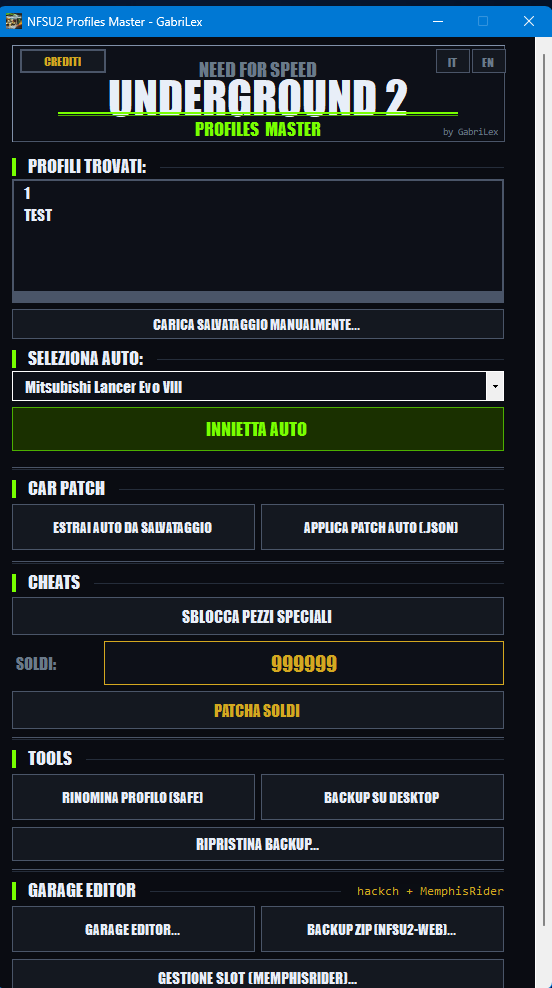
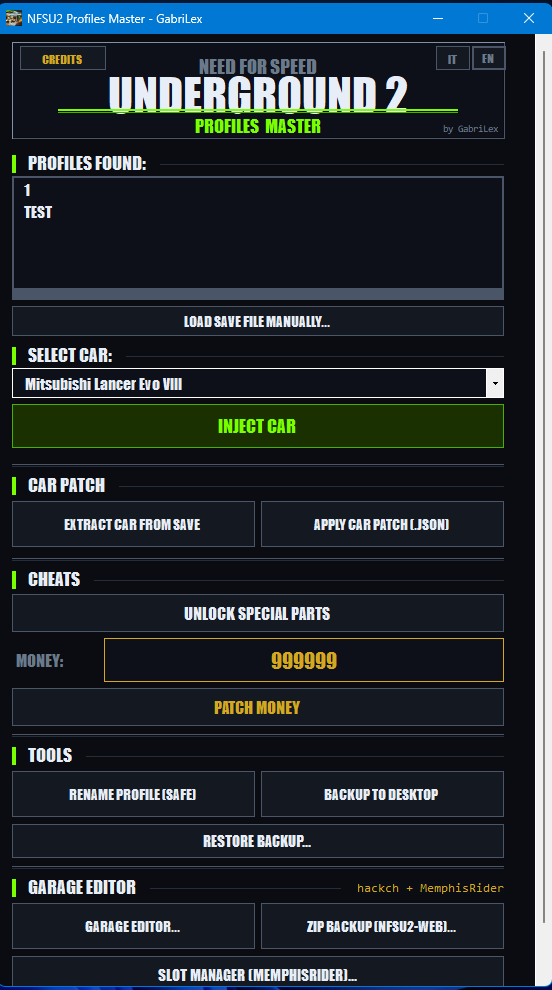

# NFSU2 Profile Master 🏁

A lightweight, user-friendly C sharp utility designed to edit savegames in **Need for Speed Underground 2**. It handles the technical heavy lifting like finding hidden save paths and bypassing Windows folder permissions.

## 🖼️ Screenshots

| Italian Interface | English Interface |
| :---: | :---: |
|  |  |

## ✨ Features

* **Auto-Detection**: Automatically finds save games in `%LOCALAPPDATA%`, `VirtualStore`, and common installation paths (including Steam versions).
* **Safety First**: Built-in "Extract" and "Restore" system to create backups before any modification.
* **Admin Privileges**: Automatically requests UAC elevation to ensure it can write save data in protected directories.
* **Bilingual**: Full support for both **Italian** and **English**.
* **Deep Scan**: Recursively searches for profile-specific files (save files with no extension) across multiple drives.
* **Rename Option**
* **VEHICLE SWAP !(SLOT 1 or more)**
* **UNLOCK PARTS OPTION**
* **SAVEGAME CAR EXTRACTION AND PATCHING**
* **EVERY CUSTOM CAR SWAPPING**
* **MANUAL SAVEGAMES LOAD **
* Player name and money reading

HackCH stuff 

* Tuning
* Lock/Unlock slot
* Checksum Recalcolation
  

## 🛠️ How it Works

The tool modifies the save file at a specific hex offset (**41322**) where NFSU2 stores the career credit value using a little-endian 4-byte integer and other hex patches for car parts

## 📦 Compiling to .exe

dotnet publish -c Release -r win-x64 --self-contained false -o publish

## License
GPL 3 
